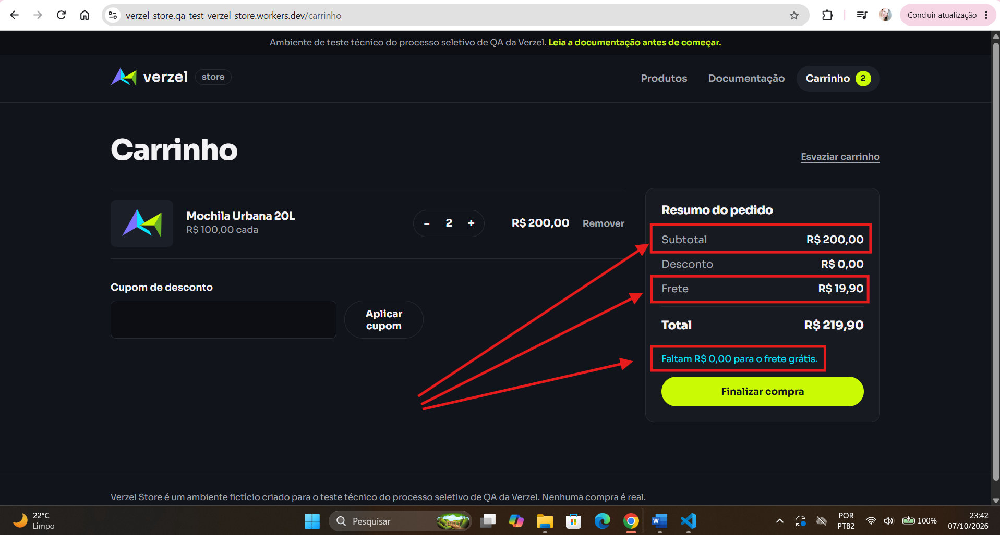
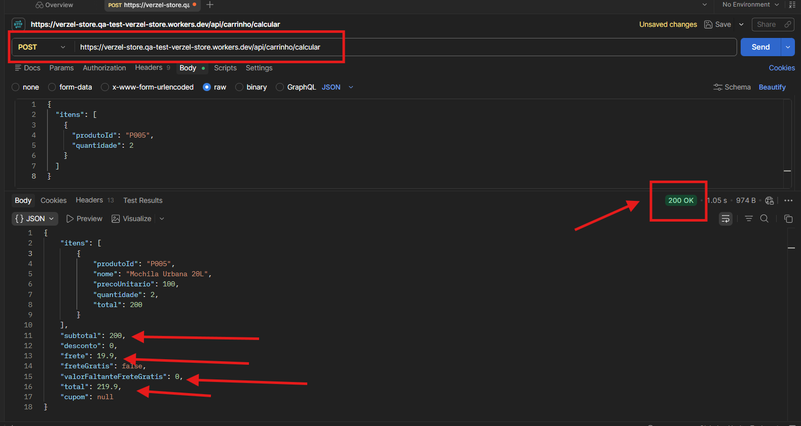

# BUG01 - Frete é cobrado para subtotal de R$ 200,00 na interface e na API

**Critérios relacionados:** CA06 

## Pré-condição
Possuir produtos no carrinho com subtotal de R$ 200,00.

## Passos para reprodução
1. Adicionar 2 unidades da "Mochila Urbana 20L" ao carrinho.
2. Verificar que o subtotal do carrinho é R$ 200,00.
3. Observar o resumo do pedido.

## Resultado esperado
O frete deve ser grátis (R$ 0,00) para o subtotal de R$ 200,00.

## Resultado obtido

Na interface, o sistema exibe e adiciona ao total o valor de R$ 19,90 referente ao frete, mesmo com o subtotal de R$ 200,00.

Também é exibida a mensagem "Faltam R$ 0,00 para o frete grátis."

Ao reproduzir a mesma condição diretamente no endpoint `POST /api/carrinho/calcular`, a API retornou:

- `subtotal`: 200;
- `frete`: 19.9;
- `freteGratis`: false;
- `valorFaltanteFreteGratis`: 0;
- `total`: 219.9.

O comportamento demonstra que a regra de frete grátis para subtotal maior ou igual a R$ 200,00 também não está sendo aplicada corretamente pela API.

## Evidências

### Interface

### API

## Severidade
Alta

