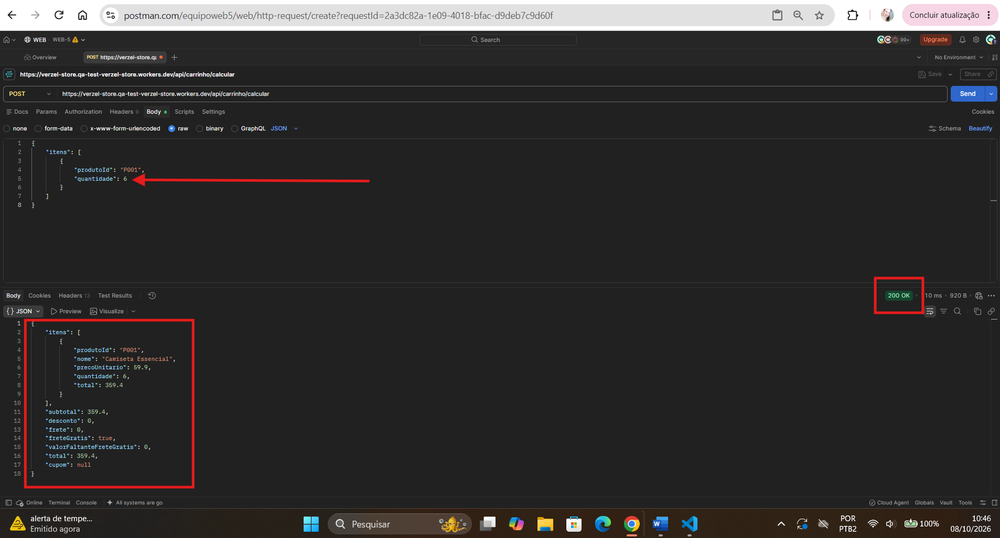
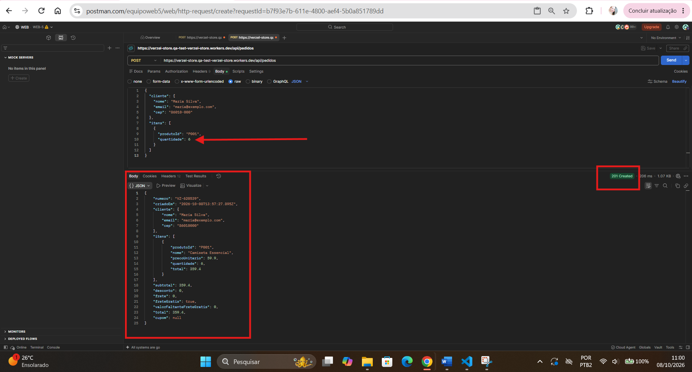

# BUG02 - API permite quantidade maior que 5 unidades por produto

**Critério relacionado:** CA10

## Pré-condição
Utilizar um produto válido existente no catálogo e, para a criação do pedido, informar dados válidos do cliente.

## Passos para reprodução

1. Enviar uma requisição POST para `/api/carrinho/calcular` com quantidade superior a 5 unidades do mesmo produto.
2. Observar a resposta da API.
3. Repetir o teste no endpoint POST `/api/pedidos`, utilizando dados válidos do cliente e quantidade superior a 5 unidades do mesmo produto.
4. Observar a resposta da API.

## Resultado esperado

A API deve rejeitar requisições com quantidade superior a 5 unidades do mesmo produto, retornando HTTP 422 com o código `QUANTIDADE_MAXIMA_EXCEDIDA`.

## Resultado obtido

O endpoint `/api/carrinho/calcular` aceitou a quantidade de 6 unidades e retornou HTTP 200, realizando normalmente o cálculo do carrinho.

O endpoint `/api/pedidos` também aceitou a quantidade de 6 unidades e retornou HTTP 201, criando o pedido normalmente.

### Reprodução via API

#### Carrinho

**Endpoint:** `POST /api/carrinho/calcular`

**Corpo da requisição:**

```json
{
  "itens": [
    {
      "produtoId": "P001",
      "quantidade": 6
    }
  ]
}
```

**Resposta obtida:**

- HTTP 200;
- a quantidade de 6 unidades foi aceita;
- o cálculo do carrinho foi realizado normalmente.

O comportamento demonstra que a regra de quantidade máxima de 5 unidades por produto não está sendo aplicada corretamente no cálculo do carrinho.

#### Pedido

**Endpoint:** `POST /api/pedidos`

**Corpo da requisição:**

```json
{
  "cliente": {
    "nome": "Maria Silva",
    "email": "maria@exemplo.com",
    "cep": "01310-100"
  },
  "itens": [
    {
      "produtoId": "P005",
      "quantidade": 6
    }
  ],
  "cupom": "BEMVINDO10"
}
```

**Resposta obtida:**

- HTTP 201;
- a quantidade de 6 unidades foi aceita;
- o pedido foi criado normalmente.

O comportamento demonstra que a regra de quantidade máxima de 5 unidades por produto também não está sendo aplicada corretamente na criação do pedido.

## Evidências

### Carrinho



### Pedido



## Severidade

Alta

## Prioridade sugerida

Alta